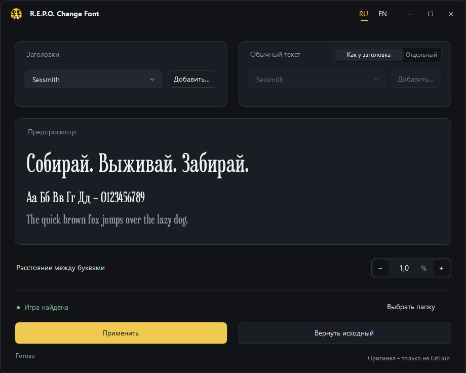

# R.E.P.O. Change Font

Утилита для Windows, которая помогает изменить шрифты заголовков и основного текста в R.E.P.O. Интерфейс доступен на русском и английском языках.

## Содержание / Contents

- [Русский](#русский)
- [English](#english)
- [License and notices](#license-and-notices)

## Русский

### Установка и использование

1. Скачайте `.exe` на странице [последнего выпуска](https://github.com/frlvv/REPO-Change-Font/releases/latest) и запустите его в Windows.
2. Выберите папку игры R.E.P.O.
3. При необходимости импортируйте собственный шрифт `.ttf` или `.otf`.
4. Выберите шрифты для заголовков и основного текста, настройте интервалы и нажмите «Применить».
5. Чтобы вернуть исходные файлы, воспользуйтесь функцией восстановления в программе.

Sexsmith доступен сразу после запуска. Программа сохраняет добавленные шрифты в библиотеке и создаёт резервную копию исходного файла игры.

### Официальный источник

Официальные сборки доступны только в выпусках этого репозитория. Проверяйте SHA-256 файла по значению, опубликованному в официальном выпуске. Автор не несёт ответственности за изменённые, перепакованные или заражённые файлы из сторонних источников. Используйте программу на свой риск.

## English

A Windows utility for changing heading and body fonts in R.E.P.O., with Russian and English interfaces.

### Getting started

1. Download the `.exe` from the [latest release](https://github.com/frlvv/REPO-Change-Font/releases/latest) and run it on Windows.
2. Select your R.E.P.O. game folder.
3. Optionally import your own `.ttf` or `.otf` font.
4. Choose the heading and body fonts, adjust spacing, and select Apply.
5. Use the restore function to return the original files.

Sexsmith is included by default. Imported fonts stay in the app’s library, and the original game file is backed up automatically.

### Official source

Official binaries are distributed only through this repository’s releases. Compare the file’s SHA-256 with the value published in the official release. The author is not responsible for modified, repackaged, or infected binaries obtained elsewhere. Use the software at your own risk.

## License and notices

Project code uses the [MIT License](LICENSE). Sexsmith by Ray Larabie is dedicated under CC0 1.0; see [NOTICE](NOTICE.md). R.E.P.O. and related marks belong to their respective owners. This project is not affiliated with the game’s creators. [Build from source](BUILD.md).
