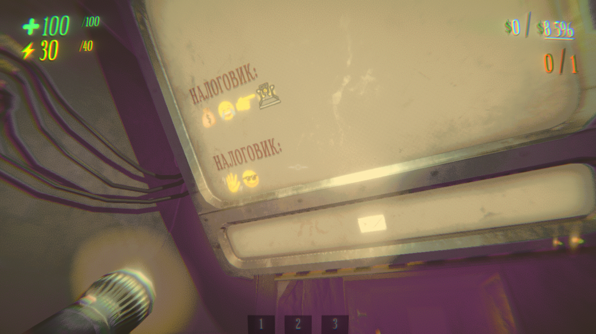

# R.E.P.O. Change Font

Утилита для замены шрифтов в игре [R.E.P.O.](https://store.steampowered.com/app/3241660/REPO/) без использования модификаций и сторонних загрузчиков.

<table width="100%">
  <tr>
    <td width="56%" valign="top">
      
    </td>
    <td width="44%" valign="top">
      
      
    </td>
  </tr>
</table>

## Содержание

* [Русский](#русский)
  * [Возможности](#возможности)
  * [Установка и использование](#установка-и-использование)
  * [Официальный источник](#официальный-источник)
* [English](#english)
  * [Features](#features)
  * [Getting started](#getting-started)
  * [Official source](#official-source)
* [License and notices](#license-and-notices)

## Русский

В официальном обновлении [R.E.P.O.](https://store.steampowered.com/app/3241660/REPO/) появился русский язык, но для кириллицы в игре используется стандартный системный шрифт, который выбивается из общего визуального стиля.

**R.E.P.O. Change Font** заменяет шрифт напрямую в ресурсах игры. Программа не требует установки BepInEx или мод-менеджеров, а сама игра и Steam не определяют эту замену как стороннее вмешательство в файлы клиента.

### Возможности

* Замена шрифта работает без загрузчиков модов и не мешает совместной игре в обычных лобби.
* Шрифт **Sexsmith** уже встроен в программу и доступен сразу после применения.
* Через кнопку «Добавить...» можно загрузить любые собственные шрифты в форматах `.ttf` и `.otf`, которые сохранятся во внутренней библиотеке программы.
* Шрифты можно настроить как отдельно, так и раздельно для заголовков и обычного текста.
* Встроенное окно предпросмотра и ползунок межбуквенного интервала позволяют оценить результат до запуска игры.
* Перед применением изменений программа автоматически создает резервную копию исходного файла игры и позволяет вернуть стандартный шрифт кнопкой «Вернуть исходный».

### Установка и использование

1. Скачайте и запустите `.exe` из [последнего выпуска](https://github.com/frlvv/REPO-Change-Font/releases/latest).
2. Выберите папку игры R.E.P.O. (если игра установлена в стандартную директорию, программа найдет ее автоматически).
3. Используйте встроенный шрифт **Sexsmith** или импортируйте собственный файл `.ttf` / `.otf`.
4. Выберите шрифты для заголовков и основного текста, настройте расстояние между буквами и нажмите «Применить».
5. Чтобы вернуть стандартные шрифты игры, нажмите «Вернуть исходный».

### Официальный источник

Официальные сборки публикуются только в [разделе выпусков этого репозитория](https://github.com/frlvv/REPO-Change-Font/releases). Вы можете сверить хеш SHA-256 скачанного файла со значением на странице релиза или собрать проект самостоятельно по инструкции в `BUILD.md`. Автор не несет ответственности за измененные или перепакованные файлы со сторонних ресурсов. Используйте программу на свой риск.

## English

A standalone utility for changing heading and body fonts in [R.E.P.O.](https://store.steampowered.com/app/3241660/REPO/) without BepInEx or mod managers.

### Features

* Works directly with game assets without mod loaders and keeps your Steam installation clean for multiplayer lobbies.
* Includes the **Sexsmith** font by default right after launch.
* Supports importing custom `.ttf` and `.otf` fonts into the built-in library.
* Fonts can be configured separately for the title and plain text, or use one font from the title.
* Provides a live preview box with adjustable letter spacing before applying changes.
* Automatically backs up original game files and restores them with a single button click.

### Getting started

1. Download and run the `.exe` from the [latest release](https://github.com/frlvv/REPO-Change-Font/releases/latest).
2. Select your R.E.P.O. game folder.
3. Choose the bundled **Sexsmith** font or import your own `.ttf` or `.otf` font.
4. Pick your heading and body fonts, adjust letter spacing, and click **Apply**.
5. Use the restore button whenever you want to revert to the original game files.

### Official source

Official binaries are distributed only through [this repository’s releases](https://github.com/frlvv/REPO-Change-Font/releases). Compare the file’s SHA-256 with the value published in the official release. The author is not responsible for modified, repackaged, or infected binaries obtained elsewhere. Use the software at your own risk.

## License and notices

Project code uses the MIT License. Sexsmith by Ray Larabie is dedicated under CC0 1.0 (see `NOTICE.md`). R.E.P.O. and related marks belong to their respective owners. This project is not affiliated with the game's creators.
